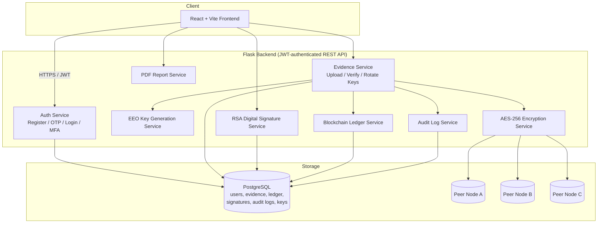

# Forensic Secure Storage

A full-stack digital forensic evidence management system, built as a final-year
project inspired by the paper *"Improving Digital Forensic Security: A Secure
Storage Model With Authentication and Optimal Key Generation Based
Encryption"* (Alashjaee & Alqahtani, IEEE Access, 2024).

It implements the paper's core ideas — authenticated access, optimizer-assisted
key generation, and a distributed blockchain-style evidence ledger — using a
production-style Flask + React + PostgreSQL stack instead of the paper's
simulation environment.

## Project overview

Investigators upload digital evidence (files) through the web app. Each file
is:
1. Hashed with **SHA-256** at the moment of upload
2. Encrypted with an **AES-256** key generated by an **EEO-inspired
   optimizer** (a population-based search that selects the fittest,
   highest-entropy candidate key rather than taking the first random draw —
   see `docs/` and inline comments in `key_generation_service.py` for the
   honest technical explanation of what this does and doesn't add over a
   plain CSPRNG)
3. Replicated to three simulated peer storage nodes (`node_a`, `node_b`,
   `node_c`), standing in for the paper's BC-distributed storage model
4. Recorded as a new block on a per-evidence **blockchain-style ledger**,
   chaining each event's hash to the previous one for tamper-evidence

From there, investigators can verify integrity on demand (re-decrypt,
re-hash, compare against the original), digitally sign evidence with RSA,
rotate encryption keys, view the full chain-of-custody audit trail, and
export a PDF forensic report.

## Architecture



## Features

- User registration with email OTP verification
- JWT authentication + role-based access control (admin / investigator)
- Multi-factor authentication (TOTP) with QR provisioning and backup codes
- Evidence upload with metadata capture (case number, title, description)
- SHA-256 hash generation at upload time
- On-demand integrity verification (decrypt → rehash → compare)
- AES-256 encrypted storage, keys generated via an EEO-inspired optimizer
- Per-evidence key wrapping under a master key, plus key rotation
- RSA-2048 digital signatures on evidence hashes, with verification
- Blockchain-style evidence ledger (chained block hashes per evidence item)
- Distributed peer storage simulation (3 nodes) with consistency checking
- Chain-of-custody audit logs (admin-visible, full activity trail)
- Dashboard with charts (status breakdown, evidence per case)
- PDF forensic report export (case details, hashes, signatures, ledger)
- Dockerized full stack (Postgres + Flask + React/Nginx)
- AWS EC2 deployment guide with Nginx reverse proxy + Let's Encrypt HTTPS

## Tech stack

| Layer | Technology |
|---|---|
| Frontend | React 19, Vite, React Router, Axios, Tailwind CSS v4, Recharts |
| Backend | Python 3.12, Flask, Flask-JWT-Extended, Flask-Bcrypt, Flask-Mail, SQLAlchemy |
| Crypto | `cryptography` (AES-256/Fernet, RSA-2048), `pyotp` (TOTP), `hashlib` (SHA-256) |
| Database | PostgreSQL 16 |
| Reports | ReportLab |
| Deployment | Docker, Docker Compose, AWS EC2, Nginx, Let's Encrypt |

## Getting started

Pick one path:

- **Docker (fastest, closest to production)** — see below
- **Local dev without Docker** — see `docs/LOCAL_INSTALL.md`

### Quick start with Docker

```bash
git clone https://github.com/your-username/forensic-secure-storage.git
cd forensic-secure-storage
cp .env.example .env     # Windows CMD: copy .env.example .env
# edit .env: SECRET_KEY, JWT_SECRET_KEY, MAIL_USERNAME, MAIL_PASSWORD (Gmail App Password)
docker compose up --build
docker compose exec backend python check_email.py   # verifies SMTP login
```

Frontend: http://localhost:5173
Backend API: http://localhost:5000/api
Health check: http://localhost:5000/api/health

## Configuration

All settings live in ONE file, `.env` in the project root (copy `.env.example`). Docker Compose passes it to the backend container (`env_file`). `backend/.env` is optional, only for running `python run.py` without Docker. Full Gmail/Windows walkthrough: [`docs/SETUP_WINDOWS_GMAIL.md`](docs/SETUP_WINDOWS_GMAIL.md).

Backend environment variables:

| Variable | Purpose |
|---|---|
| `SECRET_KEY` | Flask session secret |
| `JWT_SECRET_KEY` | JWT signing secret |
| `DATABASE_URL` | PostgreSQL connection string |
| `MAIL_SERVER`, `MAIL_PORT`, `MAIL_USE_TLS`, `MAIL_USERNAME`, `MAIL_PASSWORD`, `MAIL_FROM` | SMTP for OTP emails (`SMTP_*` aliases accepted) |
| `OTP_TTL_MINUTES`, `OTP_RESEND_COOLDOWN_SECONDS`, `OTP_MAX_ATTEMPTS`, `OTP_MAX_SENDS_PER_HOUR` | OTP policy (defaults 10 / 60 / 5 / 5) |
| `MAX_UPLOAD_MB`, `ALLOWED_UPLOAD_EXTENSIONS` | Evidence upload limits |
| `FLASK_ENV` | `production` refuses placeholder secrets and hides SMTP diagnostics |
| `STORAGE_PATH`, `MASTER_KEY_PATH` | Where encrypted evidence and the master wrapping key live |
| `NODE_A_PATH`, `NODE_B_PATH`, `NODE_C_PATH` | Peer storage simulation folders |
| `FRONTEND_ORIGIN` | Allowed CORS origin(s), comma-separated |

Frontend environment variables (`frontend/.env`, see `frontend/.env.example`):

| Variable | Purpose |
|---|---|
| `VITE_API_BASE_URL` | Backend API base URL (baked in at build time) |

Full setup walkthroughs:
- [`docs/DATABASE_SETUP.md`](docs/DATABASE_SETUP.md) — PostgreSQL install & config
- [`docs/LOCAL_INSTALL.md`](docs/LOCAL_INSTALL.md) — Windows/Ubuntu, no Docker
- [`docs/AWS_DEPLOYMENT.md`](docs/AWS_DEPLOYMENT.md) — EC2 + Docker + HTTPS

## API documentation

All endpoints are prefixed `/api`. Full request/response examples: see
[`docs/TESTING.md`](docs/TESTING.md) (curl walkthrough + demo script) and
[`docs/postman_collection.json`](docs/postman_collection.json) (importable
Postman collection).

| Method | Endpoint | Auth | Description |
|---|---|---|---|
| POST | `/auth/register` | - | Create account, sends OTP |
| POST | `/auth/verify-otp` | - | Verify email with OTP |
| POST | `/auth/resend-otp` | - | Resend OTP (60 s cooldown, 5/hour) |
| POST | `/auth/forgot-password` | - | E-mail a password-reset OTP |
| POST | `/auth/verify-reset-otp` | - | Verify reset OTP, returns single-use reset token |
| POST | `/auth/reset-password` | - | Set new password (needs the reset token) |
| POST | `/auth/login` | - | Login, returns JWT |
| GET | `/auth/me` | JWT | Current user profile |
| POST | `/evidence/upload` | JWT | Upload + encrypt evidence |
| GET | `/evidence` | JWT | List evidence (own items; admins see all) |
| GET | `/evidence/upload-rules` | JWT | Allowed extensions + max size |
| GET | `/evidence/:id/view` | JWT | Integrity-checked inline preview (images, PDF, text) |
| GET | `/evidence/:id/download` | JWT | Integrity-checked download of the decrypted original |
| GET | `/evidence/:id` | JWT | Evidence detail |
| POST | `/evidence/:id/verify` | JWT | Verify integrity |
| GET | `/evidence/:id/ledger` | JWT | Blockchain ledger for this evidence |
| GET | `/evidence/:id/nodes` | JWT | Peer node consistency check |
| POST | `/evidence/:id/rotate-key` | JWT | Rotate the encryption key |
| POST | `/signatures/:id/sign` | JWT | RSA-sign the evidence hash |
| GET | `/signatures/:id/verify` | JWT | Verify all signatures |
| GET | `/reports/:id` | JWT | Download PDF report |
| GET | `/audit-logs` | JWT (admin) | Full audit log |
| GET | `/audit-logs/evidence/:id` | JWT | Audit log for one evidence item |
| POST | `/mfa/setup` | JWT | Start TOTP setup, returns QR |
| POST | `/mfa/confirm` | JWT | Confirm TOTP, returns backup codes |
| POST | `/mfa/disable` | JWT | Disable MFA |
| POST | `/mfa/verify-backup-code` | JWT | Consume a backup code |
| GET | `/health` | - | Health check |

## Screenshots

*(Add screenshots here after running the app — Dashboard, Upload Evidence,
Evidence Details, Ledger timeline, PDF report, MFA setup.)*

```
docs/screenshots/dashboard.png
docs/screenshots/upload.png
docs/screenshots/evidence-detail.png
docs/screenshots/pdf-report.png
```

## Testing

See [`docs/TESTING.md`](docs/TESTING.md) for the full curl walkthrough, a
12-step demo script suitable for a viva presentation, and Postman collection
instructions.

## Deployment

See [`docs/AWS_DEPLOYMENT.md`](docs/AWS_DEPLOYMENT.md) for the full EC2 guide
(security groups, Docker install, Nginx reverse proxy, Let's Encrypt HTTPS,
and an outline for migrating storage to S3).

## Troubleshooting

| Symptom | Fix |
|---|---|
| `psycopg2` install fails | Install `libpq-dev` (Ubuntu) or use the Docker path, which handles this automatically |
| OTP email never arrives | Run `docker compose exec backend python check_email.py`. Use a Gmail App Password; after editing `.env` run `docker compose up -d --force-recreate backend`. The API no longer returns the OTP - the UI shows the real send error. |
| CORS errors in browser console | `FRONTEND_ORIGIN` in backend `.env` must exactly match the URL you're browsing from |
| `Evidence not found` after upload | Confirm `STORAGE_PATH` is writable and the backend process has permission to create `storage/uploads/` |
| Frontend can't reach backend | `VITE_API_BASE_URL` is baked in at **build time** for the Docker/production build — rebuild the frontend container after changing it |
| Verify always reports tampered | Check that `MASTER_KEY_PATH` points to a persistent location — if it's regenerated (e.g. volume wiped), previously wrapped keys can no longer be unwrapped |

## Scope notes (for your report / viva)

Two deliberate scoping decisions worth mentioning if asked:

1. **Multi-key homomorphic encryption (MHE)**, as described abstractly in the
   source paper, is not implemented as the storage-layer encryption here.
   Integrating a real MHE library into a file-storage pipeline is itself a
   substantial research undertaking. This project uses **AES-256 at rest**
   instead, which is the standard, defensible choice for evidence
   confidentiality.
2. **EEO-based key generation** here is a genuine population-based optimizer
   that selects the highest-entropy, best-balanced candidate from several
   CSPRNG-generated seeds — mirroring the paper's approach of optimizing
   candidate *selection*. The underlying cryptographic strength still comes
   from the CSPRNG and AES-256/Fernet, not from the optimizer itself; this is
   worth stating plainly rather than overclaiming novelty in the crypto
   primitive.

## Future enhancements

- ~~S3 storage~~, ~~Flask-Migrate~~, ~~auth rate limiting~~: done (see Phase 2 section); SBVM and a distributed ledger remain
- WebAuthn/FIDO2 as an MFA alternative to TOTP
- Real MHE integration for computation-on-ciphertext use cases
- Multi-region peer storage (real distinct hosts instead of local folders)

## License

This project is provided for educational purposes as a final-year academic
project. No specific license is attached — add one (MIT, Apache 2.0, etc.)
before publishing publicly if required by your institution.


## OTP, e-mail and evidence-file reference

**OTP rules:** 6 digits from `secrets`; stored only as an HMAC bound to purpose + e-mail; expires after 10 min; single use; 5 wrong tries burn the code; 60 s resend cooldown and 5 sends/hour per account; plus a per-IP limiter on the public auth endpoints (in-memory, per gunicorn worker). The OTP is never returned by the API or written to logs. A failed e-mail send now returns HTTP 502 `{"email_sent": false}` instead of a fake success.

**Evidence access:** only the uploader and admins can list/view/download/verify/sign/report an item; every refusal is audited as `ACCESS_DENIED`. Download and view decrypt in memory, recompute SHA-256 and compare with the hash stored at upload; on mismatch the file is withheld (HTTP 409), the item is flagged `tampered`, and `*_BLOCKED_INTEGRITY` is audited and added to the ledger. Audit actions: `UPLOAD_EVIDENCE`, `UPLOAD_REJECTED`, `VIEW_EVIDENCE`, `DOWNLOAD_EVIDENCE`, `ACCESS_DENIED`, `VIEW_BLOCKED_INTEGRITY`, `DOWNLOAD_BLOCKED_INTEGRITY`.

**Running the automated tests:** `cd backend && pip install -r requirements-dev.txt && python -m pytest`.


## Phase 2 upgrade - where things are
Honest status of every research feature (implemented / tested / awaiting input) is in
[`docs/ARCHITECTURE_PHASE2.md`](docs/ARCHITECTURE_PHASE2.md). Short version: migrations, S3 storage backend (emulated-S3 tested),
Equilibrium-Optimizer key generation + HKDF, and multiparty HE (OpenFHE) are done and tested; **SBVM (needs the paper)** and the
**genuinely distributed ledger/peer storage** are NOT implemented.

* Database: `flask db upgrade` (automatic in Docker) - [`docs/MIGRATIONS.md`](docs/MIGRATIONS.md)
* S3 / EC2: [`docs/AWS_S3_EC2.md`](docs/AWS_S3_EC2.md), `docker-compose.prod.yml` (never deployed by the authors)
* Tests: `cd backend && pip install -r requirements-dev.txt && python run_tests.py` -> `backend/test-results/summary.md`
* Benchmarks: [`docs/BENCHMARKS.md`](docs/BENCHMARKS.md) (local only)  - Security: [`docs/SECURITY_REPORT.md`](docs/SECURITY_REPORT.md)
* Optional MHE: `pip install -r backend/requirements-mhe.txt` (Docker: `--build-arg INSTALL_MHE=true`)
