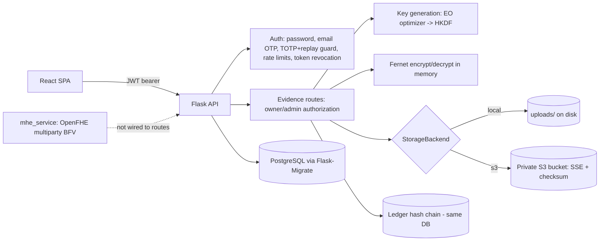
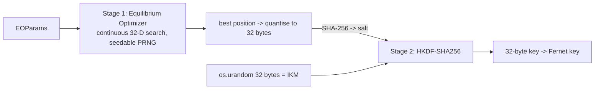

# Architecture, Phase-2 upgrade, and implementation status

## 0. Status matrix (read this first)

| Phase / feature | Status | Evidence |
|---|---|---|
| 7 Flask-Migrate migrations | **Fully implemented and tested** (real PostgreSQL 16.2 via `pgserver`, plus SQLite) | `tests/test_migrations.py` (10) |
| 6 Storage abstraction (local + S3) | **Implemented; tested against an EMULATED S3 (moto), NOT real AWS** | `tests/test_s3_storage.py` (15) |
| 6 EC2 deployment, IAM, bucket, prod compose | **Documented + config provided; never deployed** | `AWS_S3_EC2.md`, `docker-compose.prod.yml` |
| 2 Equilibrium Optimizer + HKDF key derivation | **Implemented and tested - but it is the STANDARD EO (Faramarzi 2020), not the paper's Enhanced EO.** Paper Eq. (1)-(12) were not supplied | `tests/test_key_generation.py` (28) |
| 3 Multiparty homomorphic encryption | **Implemented with real OpenFHE and tested as a service library.** It is *multiparty/threshold* HE, **not multikey HE** (no maintained library offers that). Not wired into any API route; optional install | `tests/test_mhe.py` (28) |
| 1 SBVM origin-point circle-equation authentication | **NOT implemented - awaiting the paper** (see 3) | - |
| 4 Genuinely distributed blockchain + peer storage | **NOT implemented.** The existing "3 nodes" are still three local folders and the ledger is still a hash chain in the same database. Design in 6 | `test_KNOWN_LIMITATION_*` pins the limit |
| 5 Test suite + one-command runner | **Done** (184 tests, 0 skipped on this machine) | `python run_tests.py` |
| 8 Benchmarks | **Scripts done; LOCAL single-core sandbox results only.** No multi-host or AWS numbers exist | `BENCHMARKS.md` |
| 9 Security testing | **Done for the local app** (static, dependency, active tests); 6 verified issues fixed, 2 open | `SECURITY_REPORT.md` |
| 10 Investigator UI | **Partially done**: storage backend + n/a verification states, logout revocation. Dashboard/provenance redesign, frontend unit tests: **not done**. Feedback form provided | `INVESTIGATOR_FEEDBACK.md` |
| 11 Documentation | This file + the others in `docs/` | |

Carried over from the previous change (all tested): OTP/e-mail fixes, upload validation, authorized view/download with
SHA-256 integrity checks, audit logging.

## 1. Existing architecture (as found)
Flask API + React SPA + PostgreSQL. Evidence: per-file Fernet key (generated by a "EEO" routine), wrapped by a
master key on disk, ciphertext on local disk and copied to three **local directories** (`node_a/b/c`) that simulate
peers. SHA-256 recorded at upload; ledger = per-evidence hash chain in the `ledger_blocks` table; RSA signatures;
JWT + optional TOTP MFA; email OTP; audit log. SBVM fields (`origin_x`, `origin_y`, `secret_*`) existed on `User`
but nothing validated them.

## 2. Upgraded architecture

## 3. SBVM authentication - awaiting input
The requested "origin-point circle-equation validation of a time-varying secret code" cannot be implemented without
the paper's equations (circle equation form, how the time-varying value is derived, window length, tolerance,
boundary rules). Inventing them would violate the research-accuracy requirement. **Please provide reference [1]
(or the exact equations/parameters).** What already exists and is ready to use: `users.origin_x/origin_y` are now
drawn from the OS CSPRNG at registration; the login pipeline (password -> email verification -> TOTP with replay guard ->
JWT) is where the SBVM check would be inserted, and the tests listed in the brief (expiry, replay, boundary) can be
written the moment the equations are known. TOTP replay protection (`mfa_last_used_step`) is a reusable pattern for SBVM
replay prevention.

## 4. Key generation: EO + HKDF (`key_generation_service.py`)

* Equations (standard EO, written in the function docstrings): initialization, equilibrium pool (4 best + mean),
  time term `t=(1-it/T)^(a2*it/T)`, exploration factor `F=a1*sign(r-0.5)*(e^{-λt}-1)`, generation rate
  `G=GCP*(C_eq-λC)*F` with `GCP=0.5r1 if r2>=GP`, update `C=C_eq+(C-C_eq)F+G/(λV)(1-F)`, memory saving.
  Verify against the original publication; the paper's *enhancements* are not included.
* Objective (minimised, project-defined): weighted entropy deficit, bit-balance error, longest-run penalty, lag-1 serial
  correlation of the quantised candidate. It measures statistical *quality of a byte string*; it is **not** a measure of
  cryptographic strength.
* **Security properties come from `os.urandom` + HKDF, not from the optimizer.** The optimizer output is public salt.
  A known/predicted optimizer result does not reduce key entropy. (The old code picked the best of 5 random candidates
  and mixed with Python's non-cryptographic `random`; that is gone.)
* Honest measured effect: on this objective random bytes already score well, so the optimizer's gain is small in
  absolute terms (best fitness roughly 0.0134 -> 0.0022 with 60 iterations) and key generation costs ~100 ms instead of
  ~0.4 ms (see BENCHMARKS.md). Tune `EEO_POPULATION` / `EEO_MAX_ITER` to trade time for nothing security-relevant.
* Per-key statistics (iterations, fitness, duration; never the key) are stored in `key_records.keygen_meta`.
* Fernet uses AES-128-CBC + HMAC-SHA256 (not AES-256, despite older comments).

## 5. Multiparty HE (`mhe_service.py`)
* Library choice: **OpenFHE** (BFV, multiparty mode) - verified to provide joint key generation, partial decryption
  and fusion. TenSEAL/SEAL installs but is single-key only. **No maintained library exposes multikey HE** (independent
  keys combined without joint setup), so if the paper requires that exact scheme it is **unmet**.
* Supported: add, subtract, multiply by public scalar, sum of ciphertexts; integer slots in [-32768, 32768]; results
  wrap modulo 65537. Unsupported here: ciphertext x ciphertext multiply, comparison, division, floats.
* Ownership: decryption needs a partial decryption from **every** key holder; with fewer, the service refuses and a
  direct fusion of fewer shares yields garbage (both tested). Ciphertexts are tagged with their key-set id and mixing
  key sets is refused.
* Cost: a 3-value ciphertext is ~1 MB; encrypt/decrypt ~17 ms, joint keygen ~54 ms (local measurements).
  Therefore MHE is **not** applied to evidence files (those stay under Fernet); it fits small numeric aggregates only.
* Key management: shares must live with their owners. The service never persists them; `MultipartyKeys` is an
  in-process helper. A client-side component for owners is future work, so no API route exposes MHE.
* Packaging: `requirements-mhe.txt` (optional). The OpenFHE wheel was built for Ubuntu 24.04/CPython 3.12 and its
  compatibility with the Debian-based Docker image is **unverified**; build with `--build-arg INSTALL_MHE=true` and test.

## 6. Distributed ledger and peer storage - NOT implemented (design only)
What exists is single-host: `peer_storage_service` writes to three directories and `blockchain_service` appends to a
table. Neither is distributed. A genuine design would be:
* **Ledger:** a permissioned consensus network (e.g. Hyperledger Fabric with Raft ordering, one peer per organisation/host),
  chaincode storing evidence id, SHA-256, owner, timestamps, verification results; the API signs and submits
  transactions with a client identity (mTLS + MSP certificates). Duplicate/replayed records rejected by chaincode via a
  unique evidence id + nonce.
* **Storage:** MinIO/S3 (or IPFS-cluster) across >= 3 hosts with a configurable replication factor (e.g. 3, write quorum 2),
  authenticated TLS between nodes, retrieval verified against the on-ledger hash.
* **Trust assumptions to document at build time:** node identity (certificates), peer discovery (static config or gossip),
  recovery (re-replication from healthy replicas, ledger state transfer), and the crash-fault vs Byzantine-fault model.
* Until then the Phase-4 acceptance criteria are **not met**, and the ledger limitation F-04 below applies.

## 7. API additions in this change
`POST /api/auth/logout` (revokes the token), `GET /api/evidence/upload-rules`, `GET /api/evidence/<id>/view|download`
(previous change); evidence JSON now includes `storage_backend`; verify returns `peer_node_consistency.consistent = null`
under S3. All endpoints except register/verify-otp/resend-otp/forgot/verify-reset/reset-password/login/health need a JWT.
